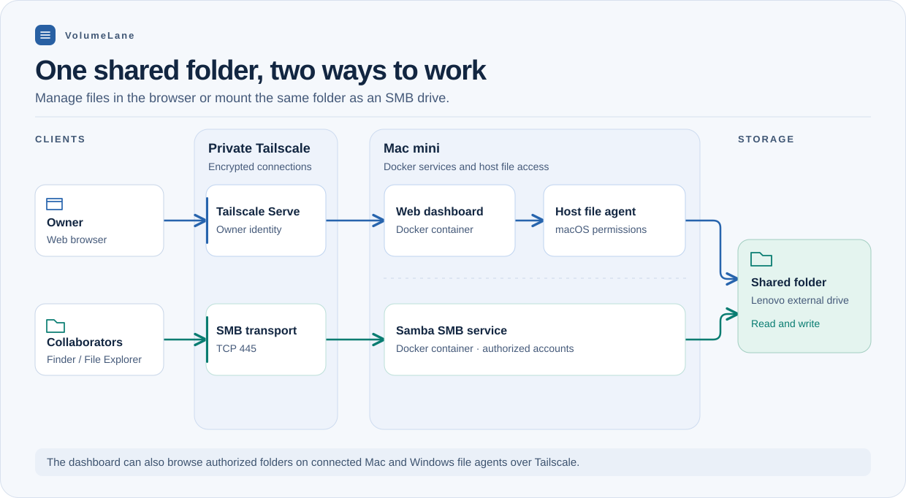
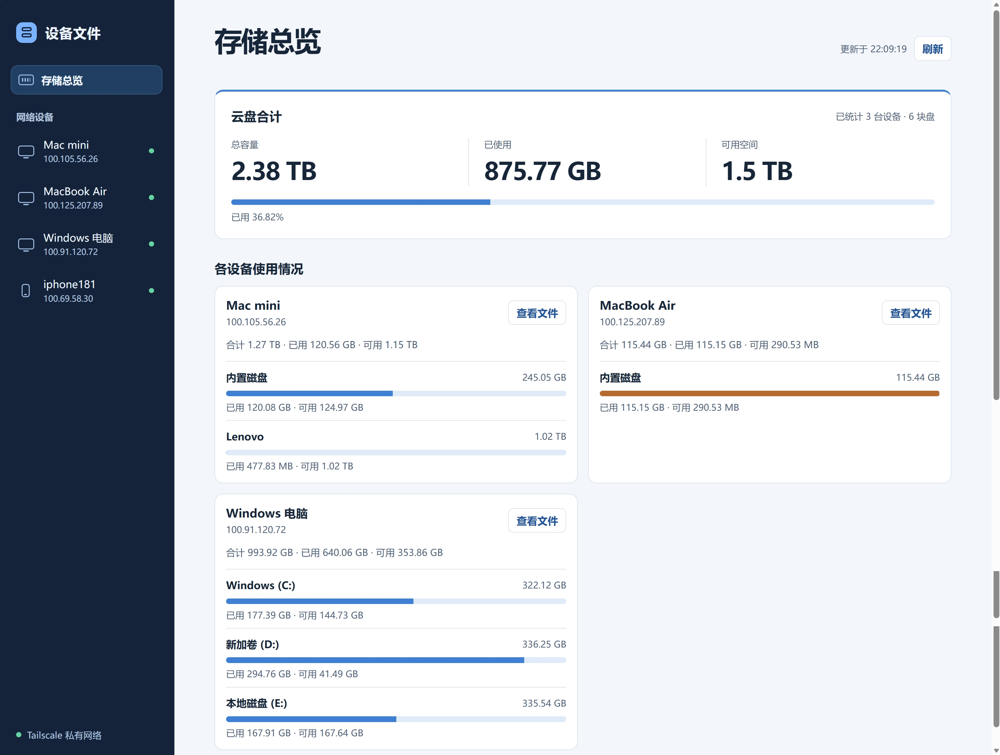
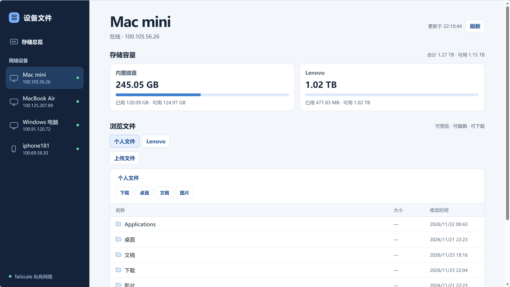
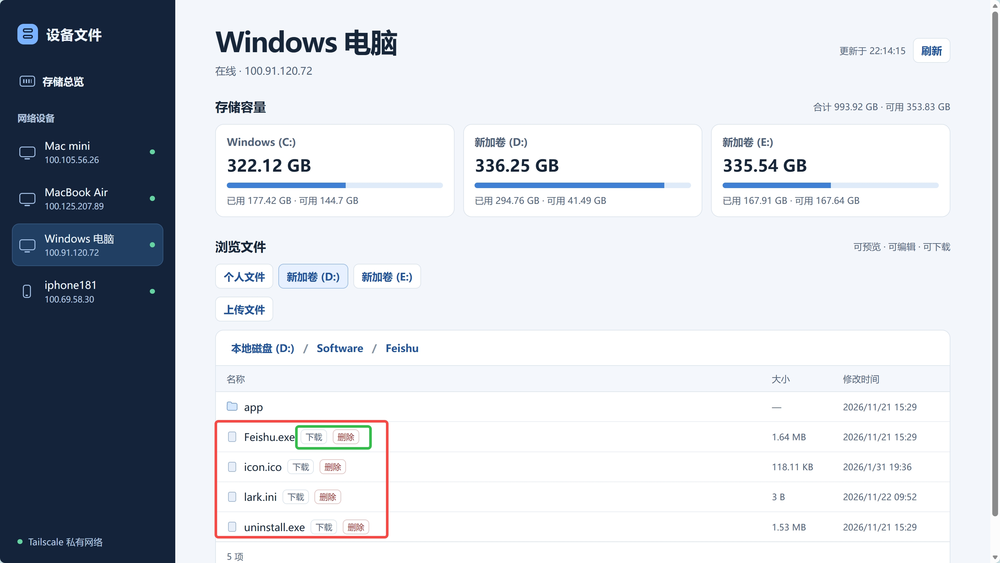

# VolumeLane

在一个网页里查看 Mac 和 Windows 的磁盘容量，浏览、下载、上传、删除文件，以及编辑文本。用一台 Mac 运行服务，通过 Tailscale 访问。



## Codex Skill · 一句话安装

在要用作主机的 Mac 上启动 Docker Desktop，并登录已启用 MagicDNS 的 Tailscale。打开这台 Mac 上的 Codex，直接粘贴下面这段话。

```text
请用 $skill-installer 安装 https://github.com/DesmondYh/VolumeLane/tree/main/skills/device-files ，然后读取该 Skill 并在这台 Mac 上部署 VolumeLane。请保留现有服务和配置，验证成功后给我 Tailscale 访问地址。
```

已安装 [VolumeLane Skill](skills/device-files) 可以直接输入 `$device-files 部署 VolumeLane`。部署脚本会生成凭据、构建并启动 Docker 网页、安装 Mac 接入程序、配置并验证 Tailscale 入口。

<details>
<summary>用终端安装</summary>

```sh
git clone https://github.com/DesmondYh/VolumeLane.git
cd VolumeLane
bash install/setup-mac.sh
```

用当前桌面用户运行。macOS 询问下载、文稿、桌面或外置卷的访问权限时，只授权想在网页里访问的位置。由脚本部署的安装支持重复运行。脚本检测到已有手动部署时会保留配置并提示按原方式维护。

</details>

## 延迟实测

总览页测量 Mac 主机到已接入设备的 Tailscale 往返延迟，按局域网和跨网分组。以下是 2026 年 11 月 24 日的测试记录。

| 网络路径 | 连接方式 | 往返延迟 |
| --- | --- | ---: |
| Mac mini ↔ MacBook Air（不同子网） | Tailscale 直连 | 7–9 ms |
| Mac mini ↔ Windows（跨网） | DERP 中继（旧金山） | 370、386 ms |
| 同子网局域网 | 待测 | 暂无已验证样本 |

在同一台 Windows 的一组接口测试中，依次读取容量和个人目录用了 722 ms，并行读取用了 528 ms。实际文件传输速度还取决于链路带宽和文件大小。

## 效果图

以下为更名前的实拍界面。

### 存储总览

[](docs/images/storage-overview.jpg)

### 浏览设备文件

| Mac mini | Windows |
| --- | --- |
| [](docs/images/mac-mini.jpg) | [](docs/images/windows-pc.jpg) |

## 按需接入

- **只想访问网页。** 在同一个 Tailscale 网络内，用安装时的账号打开脚本给出的地址。首页每 20 秒刷新容量。
- **想查看另一台电脑的硬盘。** 在主机上告诉 Codex “用 `$device-files` 接入我的 MacBook 或 Windows”，并指明设备名称。在目标电脑上打开网页，在对应设备页下载接入工具，解压后运行 `Install.command` 或 `Install.bat`。
- **想把外置盘当成共享网盘。** 让 `$device-files` 接入已挂载的外置盘目录。网页可以上传单个最大 1 GiB 的文件，也可以创建文件夹。需要从访达或 Windows 文件资源管理器读写同一目录时，配置 [SMB 网络盘](docs/smb.md)。

网页通过 Tailscale Serve 校验安装时的账号。文件留在各自的设备上，网页删除会直接删除对应文件。

## 许可证

[MIT](LICENSE)
