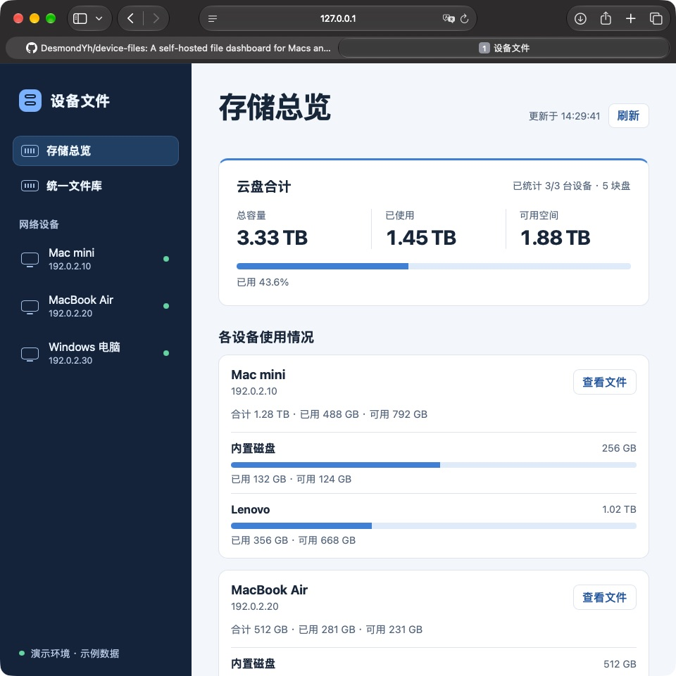
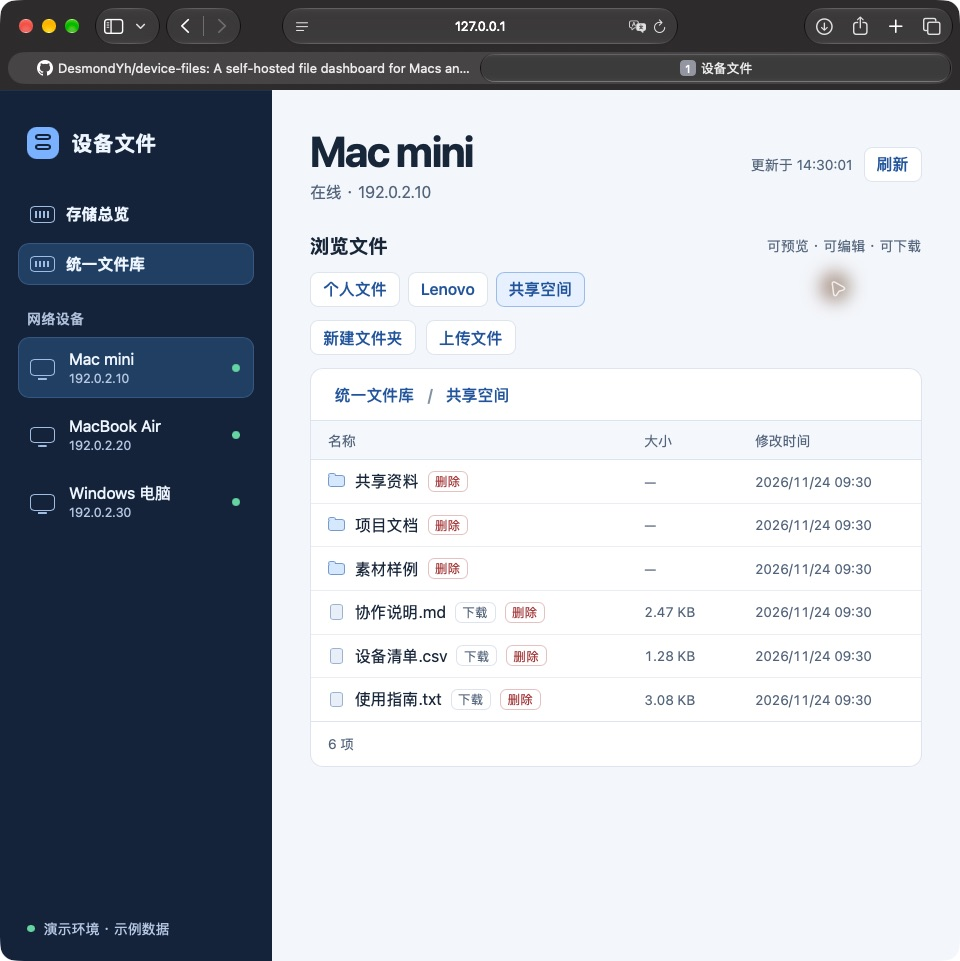

# 设备文件 · Device Files

用一个网页查看 Mac 和 Windows 的存储与文件。Docker 中的网页服务通过 Tailscale 联系各台电脑上的接入程序，支持浏览、预览、编辑文本、上传和删除。


## 效果图

以下截图使用示例设备、容量和文件。

| 存储总览 | 共享空间 |
| --- | --- |
|  |  |

## 能做什么

- 按设备和磁盘查看总容量、已用空间和可用空间。首页每 20 秒自动刷新，远端数据陆续呈现。
- 在统一文件库中切换各设备的目录。文件仍存放在对应设备上。
- 可选的外置盘共享空间支持最大 1 GiB 的单文件上传、新建文件夹和删除空文件夹。授权成员可以通过 SMB 把同一个目录挂载为网络盘。
- 文本文件支持版本检查。保存冲突时保留浏览器里的编辑内容。网页删除会直接删除文件。

## 在 Mac mini 上运行

需要 Docker Desktop（含 Compose）、Tailscale 和一个运行 macOS 的主机。接入程序以当前用户运行。Mac 和 Windows 接入程序会提供该用户可访问的个人文件及发现的本地存储位置，只向信任的账号开放。

1. 在 Mac mini 登录 Tailscale，在 Terminal 运行 `tailscale status --json`。填入 `Self.ID` 和对应 `User` 的 `LoginName`。将其他电脑的 `Peer` ID 加到 `remotes`，也可以先用空对象 `{}`。
2. 在代码目录中复制并填写示例配置。使用 `openssl rand -hex 32` 为每台设备生成独立的令牌，主机接入程序的 `token` 与网页服务的 `localToken` 相同。

   ```bash
   app_dir="$HOME/Library/Application Support/Device Files"
   install -d -m 700 "$app_dir"
   install -m 600 examples/agent.example.json "$app_dir/agent.json"
   install -m 600 examples/hub.example.json "$app_dir/hub.json"
   ```

3. 构建 Docker 镜像，提取 Mac 主机的接入程序并初始化 Docker 配置卷。

   ```bash
   docker compose build
   cli_arch=$(uname -m)
   case "$cli_arch" in arm64) agent_arch=arm64 ;; x86_64) agent_arch=amd64 ;; esac
   artifact=$(docker create device-files:local)
   docker cp "$artifact:/app/install/device-files-$agent_arch" "$app_dir/device-files"
   docker rm "$artifact"
   chmod 700 "$app_dir/device-files"
   docker volume create device-files_state
   docker run --rm -i -v device-files_state:/state alpine:3.24 \
     sh -c 'umask 077; cat > /state/hub.json && chown 65534:65534 /state/hub.json' \
     < "$app_dir/hub.json"
   ```

4. 在一个 Terminal 窗口启动接入程序并保留该窗口。macOS 弹出目录访问提示时，只允许你准备共享的目录。

   ```bash
   "$app_dir/device-files" agent "$app_dir/agent.json" 127.0.0.1:18776
   ```

   在另一个窗口回到代码目录，启动网页和 Tailscale 入口：

   ```bash
   docker compose up -d
   tailscale serve --bg --http=8766 http://127.0.0.1:18766
   ```

5. 打开 Tailscale Serve 输出的地址。MacBook 和 Windows 加入同一个 Tailscale 网络后，可以在对应设备页下载接入工具。解压并分别运行 `Install.command` 或 `Install.bat`，接入程序会在用户登录后运行。

网页通过本机 Tailscale Serve 校验身份。保留 Docker 的回环绑定，并让网页端口仅由受信任的本地进程访问。SMB 的用户权限单独配置。

## 外置盘共享空间

在 Mac mini 的外置盘上新建专用目录，在 `agent.json` 中添加 `workspace`。`mount` 是真实挂载点，`uuid` 可由 `diskutil info <挂载点>` 查看，`path` 是相对该盘根目录的路径。修改后重启主机接入程序。

```json
"workspace": {
  "mount": "/Volumes/ExternalDisk",
  "uuid": "REPLACE_WITH_VOLUME_UUID",
  "path": "Device Files/Shared"
}
```

[SMB 网络盘设置](docs/smb.md)说明如何让授权成员用访达或 Windows 文件资源管理器读写该目录。

## Codex Skill

将 [`skills/device-files`](skills/device-files) 复制到你的 Codex 技能目录（默认 `~/.codex/skills`），在 Codex 中输入 `$device-files`。这个 Skill 会引导 Codex 部署项目、接入外置盘、验证 SMB 读写和排查远程延迟。

## 许可证

[MIT](LICENSE)
